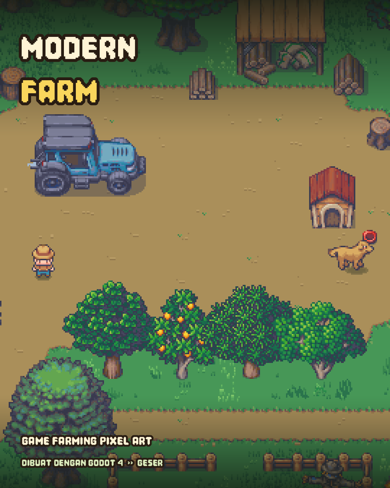
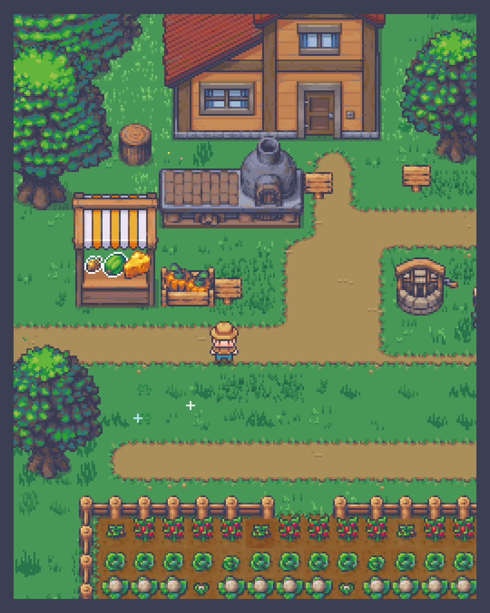
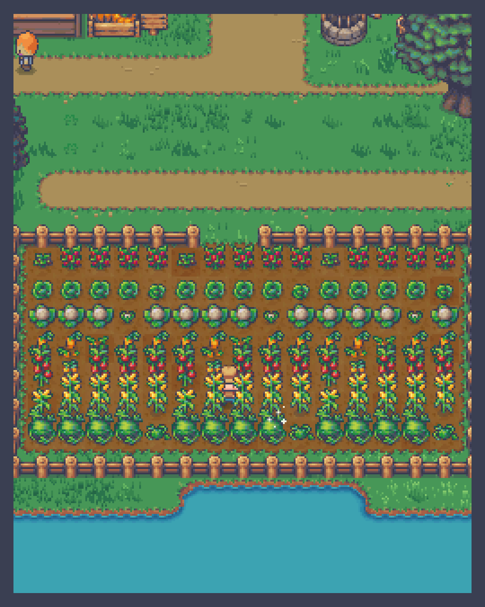
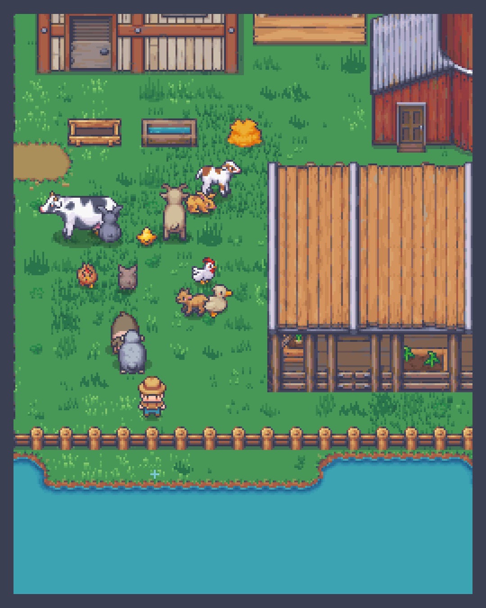
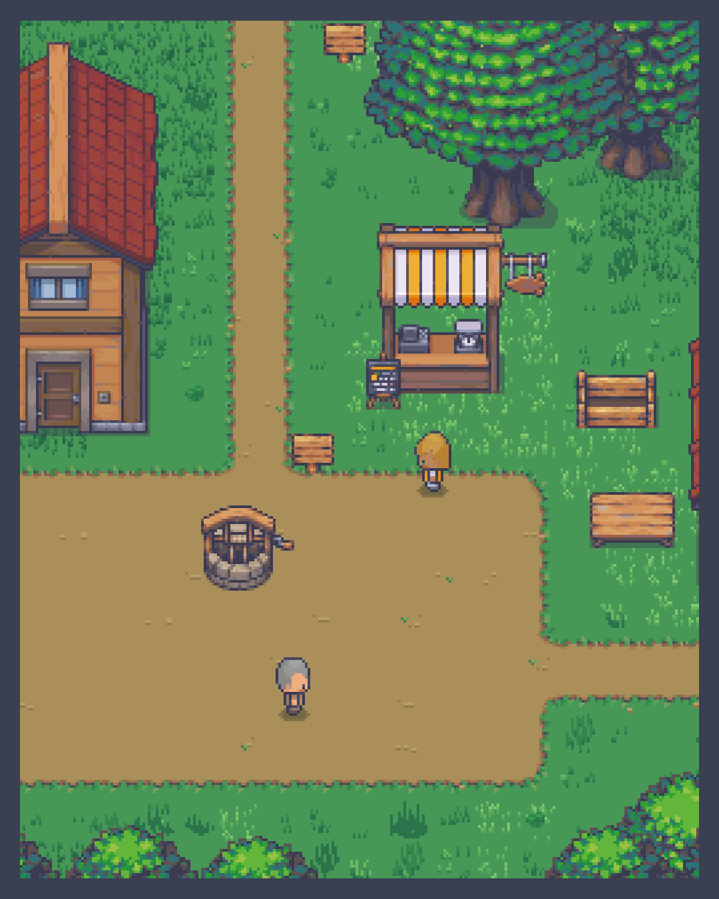
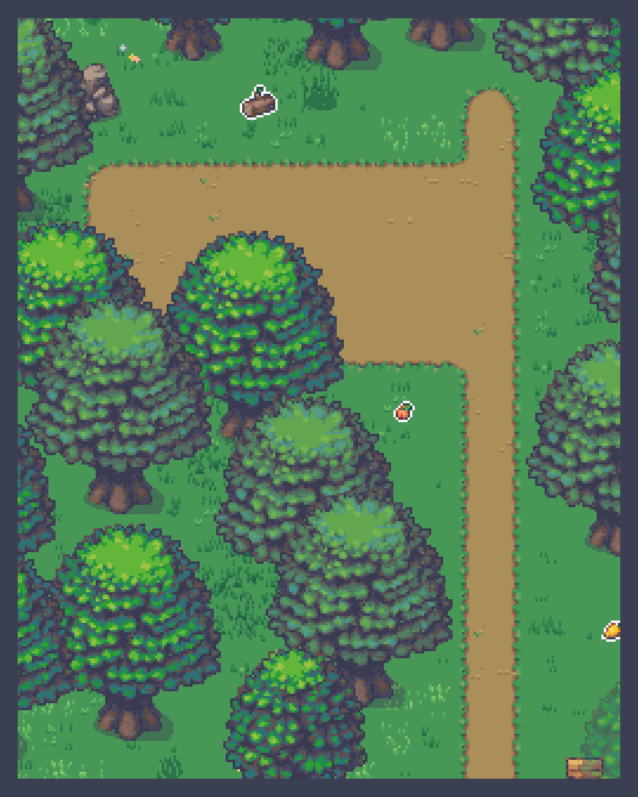
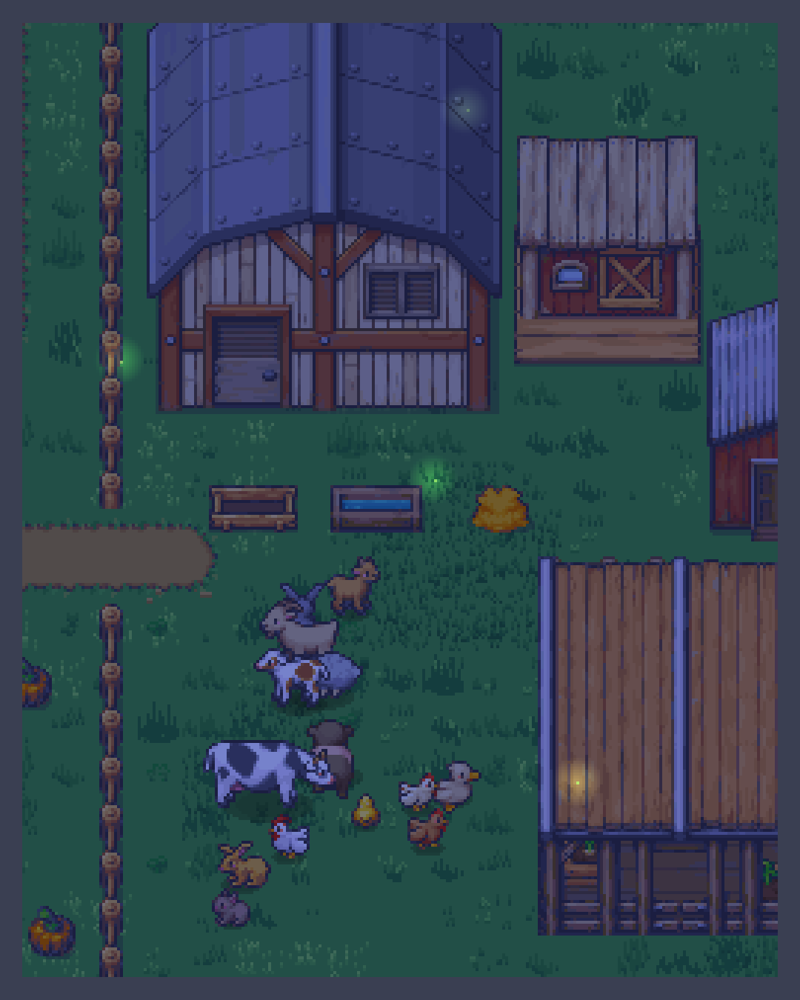

<div align="center">

# 🌾 Modern Farm

**Game farming & life-sim pixel art 2D yang dibuat dengan Godot Engine 4**

Bercocok tanam, beternak, memancing, menambang, memasak, dan membangun kehidupan di desa.




### [⬇️ Download versi Windows](../../releases/latest)

</div>

---

## ✨ Fitur

| | Fitur | Keterangan |
|---|---|---|
| 🌱 | **Bercocok tanam** | 16 jenis tanaman dengan musimnya sendiri, sprinkler, dan **panen langka** (10%, harga jual 3x) |
| 🍎 | **Pohon buah** | Lemon, persik, pisang, apel, dan jeruk yang berbuah sesuai musim |
| 🐄 | **Peternakan** | 9 jenis hewan dengan **warna acak**, bisa **beranak**, dan menghasilkan susu, telur, wol, serta keju |
| 🐕 | **Anjing peliharaan** | Mengikuti pemain, bisa dielus dan diberi makan, dan kadang membawakan hadiah |
| 🎣 | **Memancing** | Mini-game memancing dengan berbagai jenis ikan |
| ⛏️ | **Menambang** | Tambang dengan batu, tembaga, besi, emas, kristal, dan ruby |
| 🍳 | **Kerajinan & memasak** | Mesin keju, kompor, peti penyimpanan, dan resep masakan dengan buff |
| 🏘️ | **Desa & NPC** | 4 NPC dengan dialog, sistem pertemanan, toko, dan quest |
| 🛒 | **Kios pasar** | Warga desa datang membeli barang, dengan kategori "DICARI" yang berganti setiap hari |
| 🚜 | **Traktor & pekerja** | Pekerja farm otomatis dan traktor yang bisa dikendarai |
| 🌦️ | **Waktu & cuaca** | Siklus siang-malam, 4 musim, hujan, event festival, daun gugur, dan kunang-kunang |
| 💾 | **Simpan otomatis** | Semua progres tersimpan |

## 📸 Screenshot

<p align="center">
  
  
  
</p>
<p align="center">
  
  
  
</p>

## 🎮 Kontrol

| Tombol | Fungsi |
|---|---|
| `WASD` / panah | Jalan |
| `Spasi` | Pakai alat |
| `E` | Interaksi / bicara / ambil |
| `1`–`8` | Pilih slot hotbar |
| `I` | Tas |
| `J` | Daftar quest |
| `C` | Kerajinan |
| `M` | Peta |
| `Esc` | Menu / simpan |
| `F1` | Bantuan kontrol |

## ⬇️ Cara Main (Windows)

1. Download `ModernFarm_Windows.zip` dari halaman **[Releases](../../releases/latest)**.
2. Ekstrak, lalu jalankan `Modern Farm.exe`.
3. Jika muncul *"Windows protected your PC"*, klik **More info → Run anyway**.

Kebutuhan: Windows 10/11 64-bit dengan dukungan OpenGL 3.3.

## 🛠️ Menjalankan dari Source Code

> ⚠️ Aset grafis **Modern Farm** oleh LimeZu **tidak disertakan** di repo ini, karena lisensinya melarang aset disebarkan ulang. Detailnya ada di [`assets/README.md`](assets/README.md).

1. Install **[Godot 4.5+](https://godotengine.org/download)**.
2. Clone repo ini.
3. Unduh aset **Modern Farm** dari [limezu.itch.io](https://limezu.itch.io/), lalu taruh di `assets/modern_farm/`.
4. Buka `project.godot` di Godot dan tekan **F5**.

## 📂 Struktur Proyek

```
├── scenes/      # Scene Godot (farm, village, forest, mine, UI, props)
├── scripts/
│   ├── systems/    # GameManager, TimeManager, SaveManager, Audio
│   ├── farming/    # Tanah, tanaman, pohon buah, pekerja
│   ├── animals/    # Ternak, kandang, anjing peliharaan
│   ├── npc/        # NPC, dialog, pertemanan
│   ├── fishing/    # Mini-game memancing
│   ├── crafting/   # Mesin, kompor, peti, sprinkler
│   ├── shop/       # Toko & kios pasar
│   ├── quests/     # Sistem quest
│   ├── ui/         # HUD, tas, menu, peta
│   └── world/      # Peta, cuaca, resource
├── data/        # Item, tanaman, hewan, resep, quest, NPC (.tres)
└── docs/        # Catatan pengembangan per phase
```

## 📜 Catatan Pengembangan

Game ini dibuat bertahap dalam **23 phase**. Catatan setiap phase ada di folder [`docs/`](docs/).

## 🙏 Kredit

- Aset grafis: **[Modern Farm](https://limezu.itch.io/)** oleh LimeZu
- Font: [Pixel Game](https://www.fontspace.com/pixel-game-font-f121080)
- Engine: [Godot Engine](https://godotengine.org)

---

<div align="center">
Dibuat oleh <a href="https://github.com/misbah2121">@misbah2121</a>
</div>
